# Data Explorer

**Italiano** · [English](README.en.md)

Strumento **locale** per esplorare e analizzare dati tabellari (CSV, Excel, Parquet…) direttamente dal browser, senza scrivere codice e senza inviare i tuoi dati a nessun servizio esterno.

Costruito con Python, [NiceGUI](https://nicegui.io), pandas, DuckDB e ECharts. Interfaccia e messaggi sono in italiano.

Con Data Explorer puoi, tutto nella stessa applicazione:

- caricare uno o più file e controllarne la struttura;
- filtrare, ordinare, rinominare e calcolare nuove colonne;
- unire più tabelle (join e union);
- riassumere i dati con Group By, tabelle Pivot, grafici e analisi statistiche;
- esportare i risultati in Excel formattato (anche suddivisi in più file) o CSV;
- salvare i dataset in un database locale organizzato in progetti e cartelle;
- usare SQL o Python per tutto ciò che non è coperto dai pulsanti, con un assistente AI facoltativo.

<table>
<tr>
<td width="50%">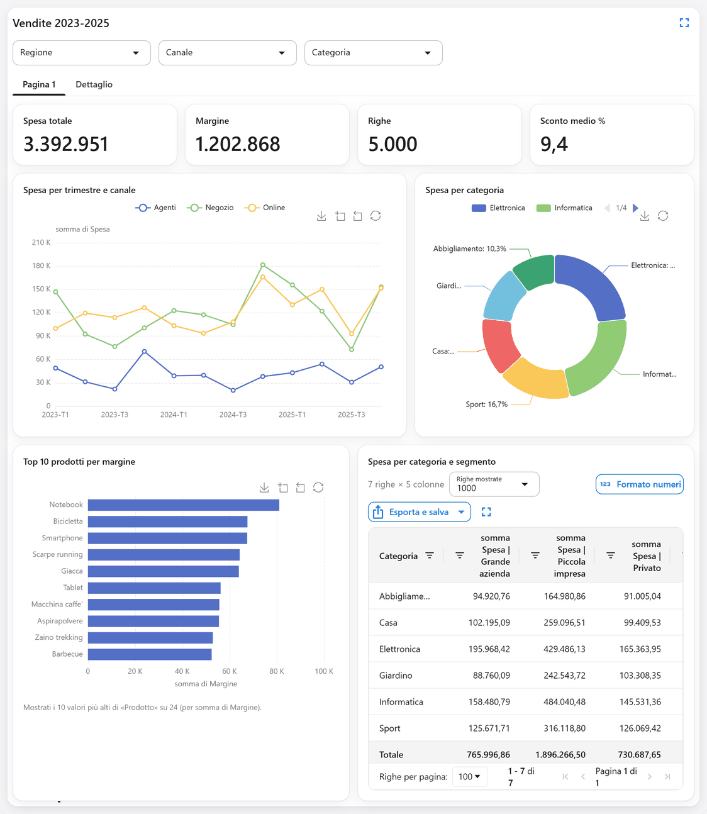</td>
<td width="50%">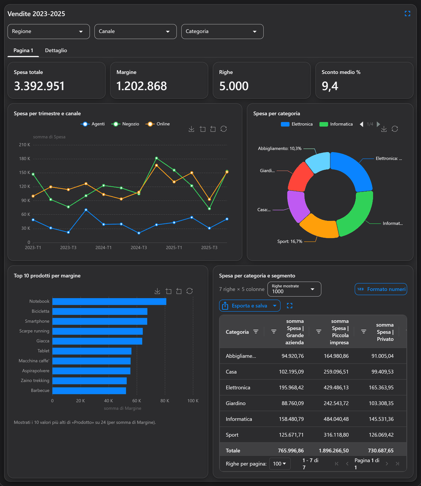</td>
</tr>
</table>

*Una dashboard interattiva costruita dalla Console con poche righe di Python, in tema chiaro e scuro.*

---

## Indice

1. [Cosa serve](#1-cosa-serve)
2. [Installazione](#2-installazione)
3. [Avvio](#3-avvio)
4. [Primi passi in 10 minuti](#4-primi-passi-in-10-minuti)
5. [Caricare i dati](#5-caricare-i-dati)
6. [Come è fatta la schermata](#6-come-è-fatta-la-schermata)
7. [Concetti da conoscere](#7-concetti-da-conoscere)
8. [Guida alle sezioni](#8-guida-alle-sezioni)
9. [Esportare e salvare i risultati](#9-esportare-e-salvare-i-risultati)
10. [Database dei dataset](#10-database-dei-dataset)
11. [Assistente AI (facoltativo)](#11-assistente-ai-facoltativo)
12. [Opzioni di avvio avanzate](#12-opzioni-di-avvio-avanzate)
13. [Problemi frequenti](#13-problemi-frequenti)
14. [Per chi sviluppa](#14-per-chi-sviluppa)
15. [Licenza](#15-licenza)

---

## 1. Cosa serve

| Requisito | Dettaglio |
|-----------|-----------|
| Sistema operativo | **Windows 10 o 11.** Il programma usa `pywin32` (per leggere l'intervallo selezionato in Excel e per «Apri in Excel»), che esiste solo su Windows. |
| Python | **3.10 o superiore** (sviluppato e provato con 3.12). |
| Browser | Un browser moderno (Chrome, Edge, Firefox). L'app si apre da sola nel browser predefinito. |
| Excel | Facoltativo. Serve solo per «Apri in Excel» e per «Range Excel». Per leggere e scrivere file `.xlsx` **non** serve Excel installato. |
| Chiave API Anthropic | Facoltativa. Serve solo per l'assistente AI (vedi [sezione 11](#11-assistente-ai-facoltativo)). |
| Internet | Serve solo per l'installazione iniziale e, se lo usi, per l'assistente AI. L'analisi dei dati avviene tutta sul tuo computer. |

---

## 2. Installazione

Apri il **Prompt dei comandi** (o PowerShell) e segui questi passi.

**1. Scarica il progetto**

Con Git:

```
git clone https://github.com/lorenzocorra1995-creator/Nicegui-Data-Analysis.git
cd Nicegui-Data-Analysis
```

Oppure, dalla pagina GitHub, premi **Code → Download ZIP**, estrai la cartella e aprila nel Prompt dei comandi con `cd`.

**2. Crea un ambiente virtuale** (consigliato: tiene le librerie del programma separate dal resto del tuo Python)

```
python -m venv NiceGuiApp
NiceGuiApp\Scripts\activate
```

Dopo l'attivazione vedrai `(NiceGuiApp)` all'inizio della riga.

**3. Installa le librerie**

```
python -m pip install -r requirements.txt
```

L'operazione richiede qualche minuto: vengono installati NiceGUI, pandas, DuckDB, PyArrow, openpyxl, xlsxwriter, scipy, statsmodels, anthropic, numpy e pywin32.

**4. (Facoltativo) Verifica che tutto funzioni**

```
python -m pip install pytest pytest-asyncio
python -m pytest -q
```

Al termine non devono comparire errori (alcuni test possono risultare «saltati»: è normale).

---

## 3. Avvio

Dalla cartella del progetto, con l'ambiente virtuale attivo:

```
python main.py
```

Il browser si apre da solo su **http://localhost:8090**. Se non si apre, copia quell'indirizzo nella barra del browser.

- **Per chiudere il programma** torna al Prompt dei comandi e premi `Ctrl+C`.
- **Per riaprire l'app** dopo aver chiuso solo la scheda del browser, vai di nuovo su http://localhost:8090 (finché il Prompt dei comandi è ancora in esecuzione).
- Se modifichi il codice Python, ferma il programma con `Ctrl+C` e riavvialo: non si aggiorna da solo.

Puoi anche passare subito dei file da caricare:

```
python main.py vendite.csv clienti.parquet
```

Altre opzioni (porta diversa, database in un'altra posizione) sono nella [sezione 12](#12-opzioni-di-avvio-avanzate).

> **Avvio con doppio clic (facoltativo).** `tools/build_exe.ps1` crea `DataExplorer.exe`, un avviatore senza finestra del terminale. Funziona solo se la cartella del programma si chiama `app`, contiene l'ambiente virtuale `NiceGuiApp` e l'exe si trova accanto alla cartella `app`. I messaggi di errore vanno in `logs/app.log`. Se non ti serve, ignoralo.

---

## 4. Primi passi in 10 minuti

Questo percorso ti fa toccare con mano le funzioni principali usando dati di prova.

**1. Genera i dati di esempio.** Da un secondo Prompt dei comandi (con l'ambiente attivo):

```
python tools/make_sample_sales.py
```

Crea `data/esempi/vendite_fittizie.csv`: 5.000 righe di vendite inventate (ordine, data, regione, canale, categoria, prodotto, prezzo, costo, quantità, sconto, spesa, margine). Puoi indicare un altro numero di righe: `python tools/make_sample_sales.py 20000`.

**2. Carica il file.** In alto a destra premi il pulsante **+** («Carica dataset»), poi trascina il CSV nella finestra. Si apre la finestra di importazione: lascia tutto com'è e premi **Carica**.

**3. Guarda i dati.** La sezione **Dati** mostra le prime righe e, aprendo «Struttura colonne», il tipo di ogni colonna, quanti valori mancano e quanti sono distinti.

**4. Filtra.** Apri **Filtri**, aggiungi una condizione (per esempio *Regione = Lombardia*) e premi **Applica filtri**.

**5. Riassumi.** Vai in **Group By** (menu a sinistra, gruppo *Analizza*). Come chiave scegli *Categoria*, come misura *Margine* con funzione *somma*, poi **Esegui Group By**.

**6. Disegna un grafico.** Vai in **Grafici**, scegli «Barre verticali», *Categoria* sull'asse X e *Spesa* con *somma* come valore, poi **Crea grafico**.

**7. Prova una Pivot.** In **Pivot** metti *Categoria* nelle righe, *Canale* nelle colonne, *Spesa* con *somma* nei valori e premi **Crea Pivot**. Clicca su una cella e poi su **Righe di origine** per vedere le righe che l'hanno prodotta.

**8. Esporta.** Sotto qualsiasi risultato apri il menu **Esporta e salva** e scegli *Excel*, *CSV*, *Apri in Excel*, *Salva come dataset*, *Salva nel database* o *Aggiungi al report*.

**9. Una dashboard in un clic.** In **Console** scegli *Python*, premi **Esempio di dashboard** e poi **Esegui**: ottieni una dashboard interattiva con filtri laterali, indicatori e grafici collegati tra loro.

---

## 5. Caricare i dati

### Formati supportati

| Tipo | Estensioni |
|------|------------|
| Testo | `.csv`, `.tsv`, `.txt` |
| Excel | `.xlsx`, `.xlsm`, `.xls` |
| Parquet | `.parquet`, `.pq` |
| Feather | `.feather` |
| Pickle di pandas | `.pkl`, `.pickle` |

Per i file di testo il separatore (`;`, `,`, tabulazione…) e la codifica dei caratteri vengono riconosciuti automaticamente.

### Come caricare

- **Dall'interfaccia:** pulsante **+** in alto a destra, poi trascina uno o più file nella finestra (o cliccala per scegliere i file).
- **Dalla riga di comando:** `python main.py file1.csv file2.xlsx` (vedi [sezione 12](#12-opzioni-di-avvio-avanzate)). In questo caso la finestra di importazione non compare.
- **Dal database:** pulsante **Database** in cima al menu laterale ([sezione 10](#10-database-dei-dataset)).
- **Da Jupyter:** vedi [sezione 12](#12-opzioni-di-avvio-avanzate).

Ogni dataset ha un **nome**, che di default è il nome del file senza estensione. Quel nome è anche il nome della tabella nelle query SQL della Console.

### Excel: foglio e intervallo

Caricando un file Excel compare sempre una finestra in cui scegli il **foglio** e, se vuoi, l'**intervallo di celle** da leggere (per esempio `B3:F120`). Lasciando l'intervallo vuoto si legge tutto il foglio. La prima riga dell'intervallo è usata come intestazione delle colonne.

### «Range Excel»: leggere la selezione fatta in Excel

Nella finestra di caricamento il pulsante **Range Excel** legge l'intervallo che hai selezionato in questo momento in un Excel aperto sul tuo PC (solo Windows). Il file deve essere **già salvato**: il programma legge il file dal disco, quindi se ci sono modifiche non salvate l'importazione viene rifiutata con un messaggio.

### La finestra di importazione

Dopo aver letto il file compare una finestra in cui puoi, prima di caricare:

- **tenere o togliere** colonne (pulsanti *Tutte* / *Nessuna*);
- **rinominare** le colonne;
- scegliere il **formato** di ogni colonna: *Come rilevato* (predefinito), *Testo*, *Numero*, *Numero intero*, *Data*, *Data senza ora*;
- indicare il **separatore decimale** usato nel file (virgola o punto) per le colonne da convertire in numero;
- vedere un'**anteprima** con l'avviso dei valori che andrebbero persi nella conversione;
- premere **Proponi formati** per farti suggerire i formati delle colonne lette come testo i cui valori sono tutti numeri o date (i codici con zeri iniziali, come `00123`, vengono esclusi per non perdere gli zeri);
- **Ripristina** per tornare alle scelte iniziali.

Se scegli *Testo* per una colonna che il programma aveva letto come numero o data, il file viene riletto per quella colonna, così non si perdono zeri iniziali o formati originali.

---

## 6. Come è fatta la schermata

**Barra in alto**

- Pulsante menu: mostra o nasconde il menu laterale.
- **Aspetto**: tema chiaro/scuro, temi pronti, colore d'accento, angoli, colori dei grafici e colori avanzati. Le scelte vengono ricordate tra un avvio e l'altro.
- **Dataset (N)**: elenco dei dataset caricati con le dimensioni; per ciascuno puoi **rinominarlo** o **rimuoverlo**, e da qui puoi **caricarne** altri.
- **+**: carica un dataset.

**Menu laterale (a sinistra)**

In cima il pulsante **Database**. Sotto, le sezioni in quattro gruppi:

| Gruppo | Sezioni |
|--------|---------|
| Prepara | Dati · Struttura · Colonne calcolate · Join / Union |
| Analizza | Group By · Pivot · Grafici · Statistica |
| Esporta | Excel |
| Strumenti | Console |

Sui monitor stretti il menu si chiude da solo dopo ogni scelta.

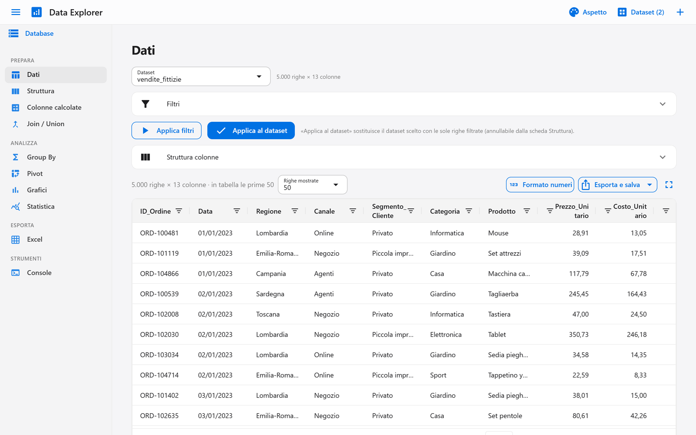

**Area di lavoro**

Occupa il resto della pagina e mostra la sezione scelta. Ogni sezione è composta da **finestre di lavoro** (vedi sotto).

---

## 7. Concetti da conoscere

### Dataset

Un dataset è una tabella caricata in memoria. Puoi averne quanti vuoi. **Non esiste un «dataset attivo» globale**: in ogni sezione scegli di volta in volta su quale dataset lavorare.

### Finestre di lavoro

In cima a ogni finestra c'è il selettore **Dataset**: è lì che decidi su quale tabella lavora quella finestra. Nelle sezioni Dati, Struttura, Colonne calcolate, Group By, Pivot, Grafici, Statistica e Console il selettore **Finestre** (da 1 a 6) permette di **impilare più finestre**, ciascuna con il suo dataset, i suoi filtri e le sue scelte. È comodo per confrontare due tabelle o due analisi senza perdere nulla.

In **Group By**, **Pivot** e **Grafici** ogni finestra ha inoltre le **sotto-finestre**: i filtri si impostano una sola volta in alto e più analisi (per esempio tre grafici diversi) leggono le stesse righe filtrate.

### Filtri

Il costruttore di filtri è lo stesso in tutto il programma (titolo **Filtri (N)**, dove N è il numero di condizioni attive). Si possono creare:

- **condizioni** (colonna + operatore + valore);
- **gruppi** annidati uniti da **AND** («tutte vere») oppure **OR** («almeno una vera»), anche gruppi dentro gruppi.

Operatori disponibili: `=` · `≠` · `>` · `<` · `>=` · `<=` · contiene · non contiene · inizia con · finisce con · in lista · non in lista · tra · regex · è nullo · non è nullo.

Suggerimenti:

- Per `=`, `≠`, «in lista» e «non in lista» su colonne di testo il programma propone i valori presenti nella colonna: puoi cercarli e sceglierli.
- Con «in lista» e «non in lista» il pulsante con l'icona degli appunti permette di incollare un elenco copiato da Excel (una cella per riga, oppure valori separati da `;`).
- I numeri accettano sia `1.234,56` sia `1,234.56`; le date si scrivono `AAAA-MM-GG`.
- In **Group By**, **Pivot**, **Grafici**, **Statistica** e **Console** i filtri vengono applicati **prima** del calcolo.

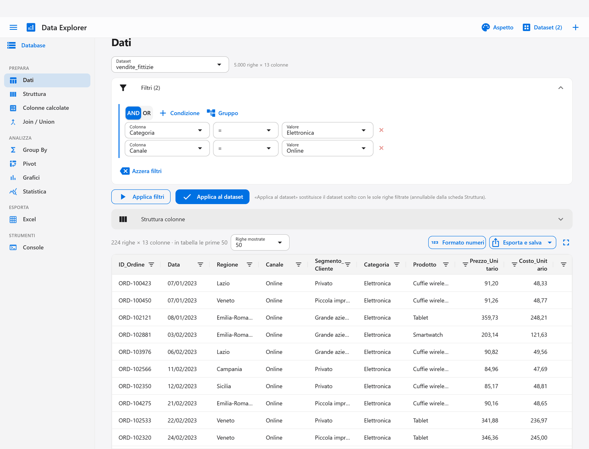

### Risultati

Ogni risultato appare in una tabella con colonne ridimensionabili, ordinabili per clic sull'intestazione e filtrabili. Sopra e sotto la tabella trovi:

- **Righe mostrate**: quante righe visualizzare (50, 100, 500, 1.000, 5.000, 10.000). Questo limita solo la **visualizzazione**: esportando si scarica sempre tutto.
- **Formato numeri**: vedi sotto.
- **Esporta e salva** e **Schermo intero**: vedi [sezione 9](#9-esportare-e-salvare-i-risultati).
- **Nota**: mostra da dove viene il risultato (file di origine, dataset, filtri applicati, operazione svolta).

### Formato numeri

Il pulsante **Formato numeri** sopra ogni tabella scelto tra:

- *Nessun formato*: i valori restano come sono;
- *Formato decimale*: scegli il numero di decimali e lo stile, **Italiano** (`1.234,56`) o **Americano** (`1,234.56`).

Il formato predefinito è «decimale, 2 cifre, stile italiano». Vale per tutte le tabelle della stessa sezione e cambia **solo la visualizzazione**: i file Excel e CSV scaricati non cambiano.

> Con il formato predefinito anche gli **interi** mostrano il separatore delle migliaia: un anno come 2024 compare come «2.024». Per vederlo senza punto scegli *Nessun formato*.

Nei grafici lo stile dei numeri si sceglie nel campo **Separatori numeri**.

### Finestre di dialogo

Tutte le finestre di dialogo si **spostano** trascinando la prima riga e si **ridimensionano** dall'angolo in basso a destra.

---

## 8. Guida alle sezioni

### Dati

Mostra il dataset scelto, con i filtri.

- **Applica filtri** mostra solo le righe che soddisfano le condizioni. Il dataset **non cambia**.
- **Applica al dataset** sostituisce davvero il dataset con le sole righe filtrate. Si può annullare dalla sezione Struttura.
- **Azzera filtri** rimuove tutte le condizioni.
- **Struttura colonne** (riquadro richiudibile): per ogni colonna mostra tipo, valori mancanti e valori distinti.

### Struttura

Per sistemare il dataset:

- **rinominare** il dataset e le colonne;
- **riordinare** le colonne e **toglierne** alcune;
- **ordinare le righe** su più livelli (per esempio prima per Regione A → Z, poi per Spesa Z → A).

Premi **Anteprima** per vedere il risultato e **Applica al dataset** per confermare. **Annulla ultima modifica** riporta il dataset allo stato precedente (la versione prima dell'ultima modifica è conservata).

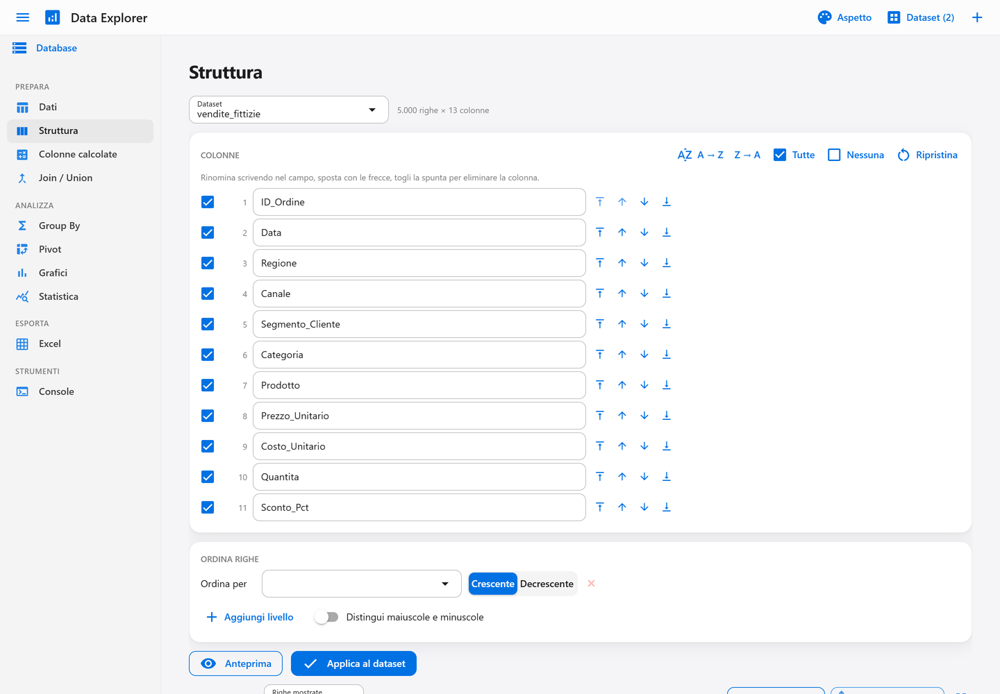

### Colonne calcolate

Crea una nuova colonna, oppure sovrascrivi una esistente, in tre modi:

| Modo | A cosa serve |
|------|--------------|
| **Cambio formato** | Converte una colonna in *Numero*, *Numero intero*, *Testo*, *Data*, *Data senza ora*, oppure ne estrae *Anno*, *Trimestre*, *Mese*, *Giorno*, *Anno-mese*. Per i numeri scritti nei file puoi indicare se il separatore decimale è la virgola o il punto. |
| **Formula** | Scrivi un'espressione (sintassi SQL di DuckDB) che usa le colonne, per esempio `"Spesa" - "Costo_Unitario" * "Quantita"`. Cliccando sui nomi delle colonne li inserisci nella formula. Il riquadro **Guida alle formule** elenca le funzioni su testo, numeri, date, logica e finestre, con esempi già calcolati. |
| **Se… allora** | Assegna un valore in base a regole, ognuna con i propri filtri («se Regione = Lombardia allora Nord»), più un valore «altrimenti». |

Scegli dove inserire la nuova colonna (dopo quale colonna), controlla l'anteprima (**Anteprima**) e premi **Applica al dataset**.

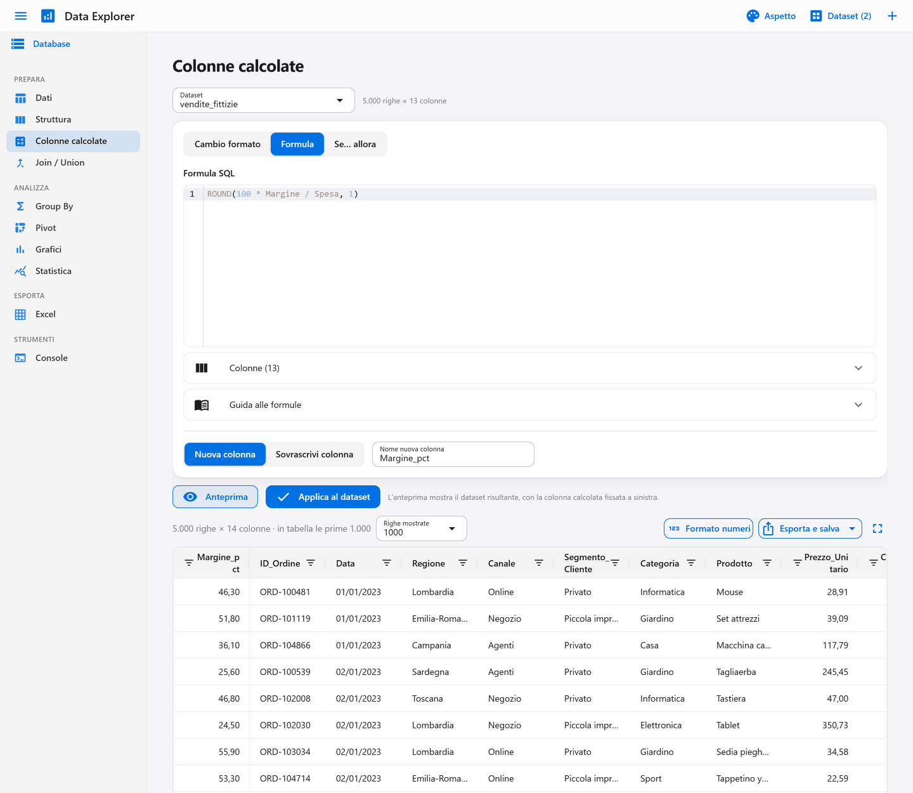

### Join / Union

Un interruttore in alto sceglie tra **Join** e **Union**.

**Join** (unire due o più tabelle per chiavi in comune)

1. Scegli il dataset di partenza e il dataset da unire.
2. Scegli il **tipo di join**: *Inner* (solo le righe con corrispondenza), *Left*, *Right*, *Full outer*, *Cross* (tutte le combinazioni), *Left semi* / *Right semi* (tieni le righe che hanno corrispondenza, senza aggiungere colonne), *Left anti* / *Right anti* (tieni le righe che **non** hanno corrispondenza).
3. Indica le **chiavi**: colonna a sinistra, operatore e colonna a destra. Il programma ne propone una in automatico.
4. Per unire un terzo dataset premi **Aggiungi join (+ dataset)**: i passi si susseguono come una catena.
5. In **Colonne del risultato** decidi quali colonne tenere e come chiamarle; le colonne con lo stesso nome vengono segnalate.
6. **Esegui join** mostra il risultato; **Applica al dataset** sostituisce il dataset di partenza con il risultato.

Le opzioni permettono di far corrispondere anche chiavi di tipo diverso «come testo», trattare i valori vuoti come uguali, aggiungere una colonna che indica da quale lato viene la riga e fondere le chiavi uguali in un'unica colonna.

Per evitare di bloccare il computer, se le chiavi hanno valori ripetuti da entrambe le parti e il risultato esploderebbe di dimensione, il join si ferma con un messaggio che lo spiega.

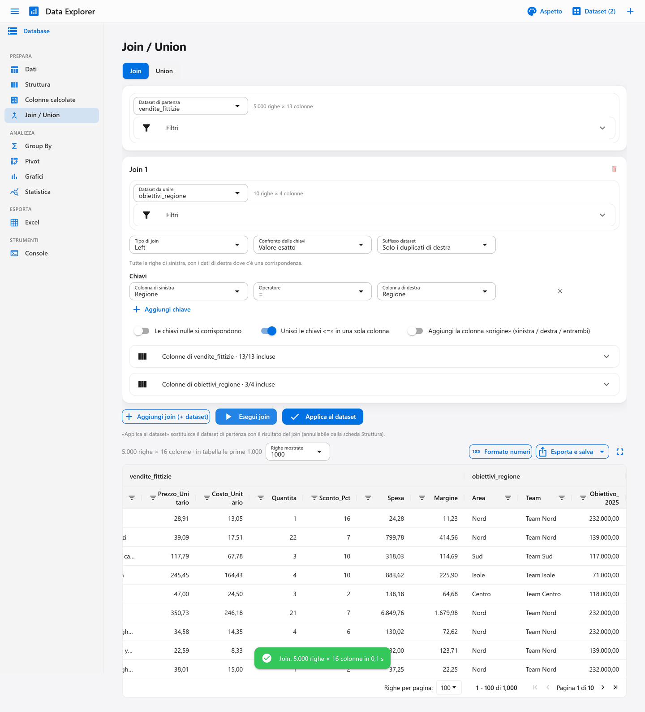

**Union** (impilare tabelle con le stesse colonne)

- **Accoda tutte le righe** (UNION ALL), **senza righe duplicate** (UNION), **solo le righe presenti in tutti i dataset** (INTERSECT), **righe del primo dataset assenti dagli altri** (EXCEPT).
- L'allineamento delle colonne può essere per nome, solo le colonne comuni, come il primo dataset o per posizione.
- Puoi aggiungere una colonna con il dataset di origine di ogni riga, e filtrare ciascun dataset prima di unirlo.
- **Esegui union** mostra il risultato.

### Group By

Raggruppa le righe e calcola riepiloghi.

1. Scegli una o più **colonne chiave** (i gruppi).
2. Aggiungi le **misure**: una colonna e una funzione per ciascuna. Funzioni: somma, media, mediana, conteggio, distinti, min, max, primo, ultimo, dev.std, varianza, range, q1, q3, moda, nulli, % nulli. Il programma propone solo le funzioni sensate per il tipo della colonna (per esempio non la somma di un testo).
3. Scegli come **chiamare le colonne** del risultato (per esempio «somma Spesa» o «Spesa (somma)») oppure dai un nome personalizzato a ogni misura.
4. **Esegui Group By**.

In alto un interruttore sceglie tra **Aggregazioni** (quanto descritto sopra) e **Value counts**, che conta quante volte compare ogni valore delle colonne scelte, con la percentuale, per ogni gruppo.

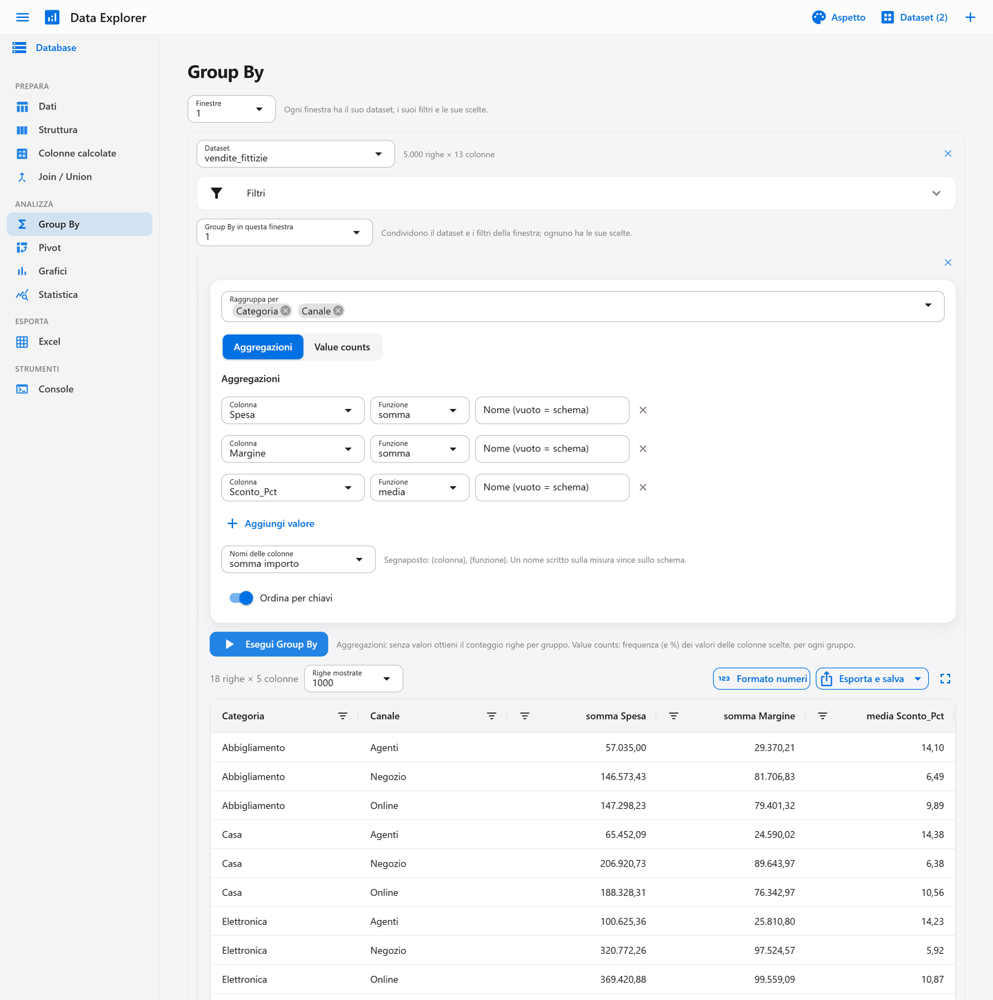

<details>
<summary>Value counts</summary>

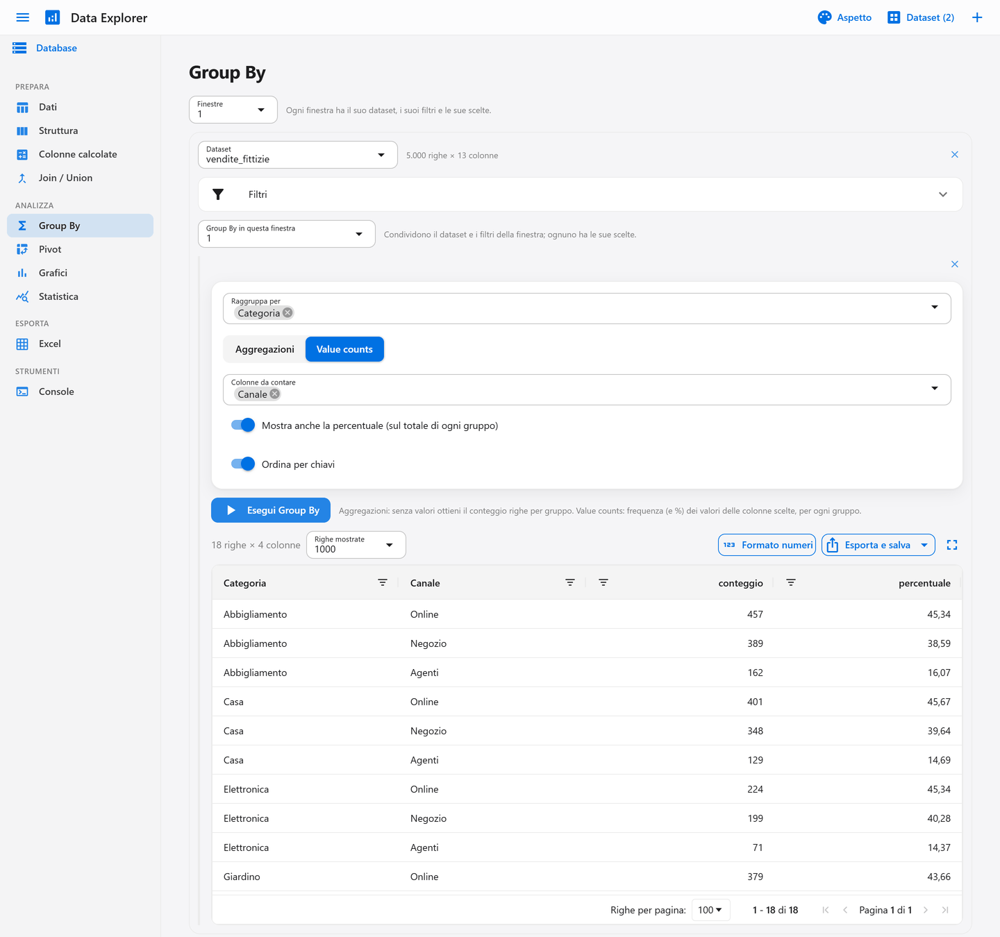

</details>

### Pivot

Una tabella pivot come quella di Excel, ma con più possibilità.

1. Scegli i campi delle **Righe** e delle **Colonne** (anche più di uno, con sottototali).
2. Per i campi data scegli come raggrupparli (anno, trimestre, mese…).
3. Aggiungi i **Valori**: colonna + funzione, come nel Group By.
4. Imposta il **Layout**: totali e subtotali, celle vuote, ordinamento (per etichetta o per valore) e nomi delle colonne.
5. Per ogni valore puoi scegliere **«Mostra valori come»**: % di (totale, riga, colonna…), differenza da, differenza % da, totale progressivo, % progressiva, rango, indice.
6. Premi **Crea Pivot**.

Cliccando su una cella e poi su **Righe di origine** vedi esattamente le righe del dataset che hanno prodotto quel numero. Se la pivot avesse troppe colonne (oltre 500) il programma lo segnala e suggerisce di filtrare o di spostare un campo nelle righe.

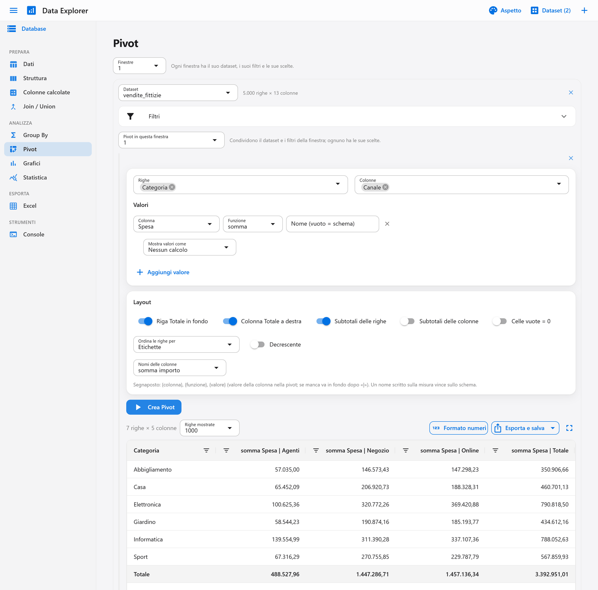

<details>
<summary>Un'altra pivot: categoria per anno</summary>

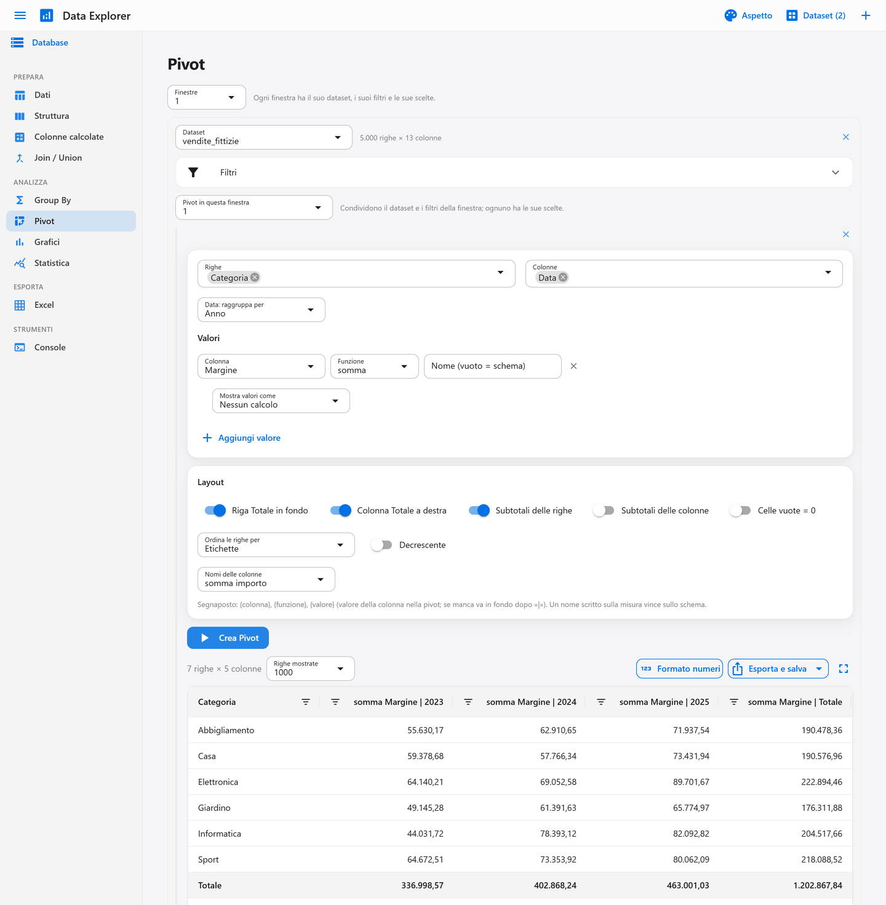

</details>

### Grafici

23 tipi di grafico, in cinque famiglie:

| Famiglia | Tipi |
|----------|------|
| Confronto | Barre verticali, orizzontali, in pila, in pila 100%, Barre + linee (doppio asse), Pareto |
| Andamento | Linee, Linee a gradini, Area, Area in pila |
| Composizione | Torta, Ciambella, Rosa (Nightingale), Treemap, Imbuto |
| Distribuzione | Istogramma, Box plot, Dispersione, Bolle |
| Relazioni | Mappa di calore, Radar |

Nel riquadro **Costruzione del grafico**:

- **Dati**: scegli il tipo, le colonne (asse X, serie, valori, dimensione delle bolle…) e le funzioni; per le date scegli l'unità (giorno, mese…); con **Top N** puoi tenere solo i valori più alti o più bassi raggruppando il resto in «Altri»; puoi ordinare per valore o per etichetta.
- **Pannelli**: crea un grafico piccolo per ogni valore di una colonna, con scala e colori comuni.
- **Aspetto**: titolo, etichette dei valori, decimali, numeri compatti (1,2 K · 3,4 Mln · 5 Mrd), linee smussate, linea della media, altezza, stile dei numeri.
- Premi **Crea grafico**.

**Clicca su una barra, una fetta o un punto** per vedere le righe del dataset che lo compongono. La tabella dei dati del grafico è nel riquadro sotto.

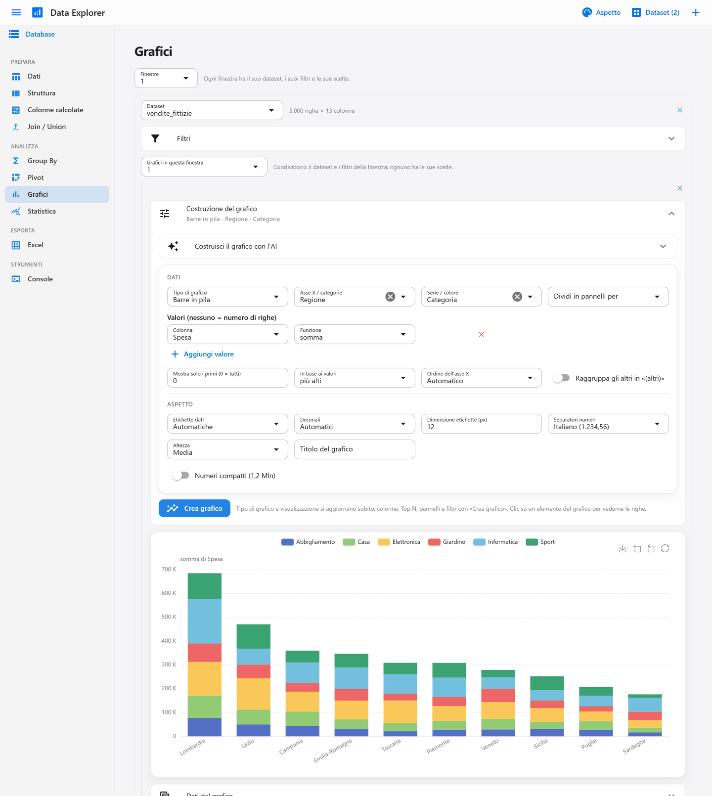

<details>
<summary>Altri esempi di grafici</summary>

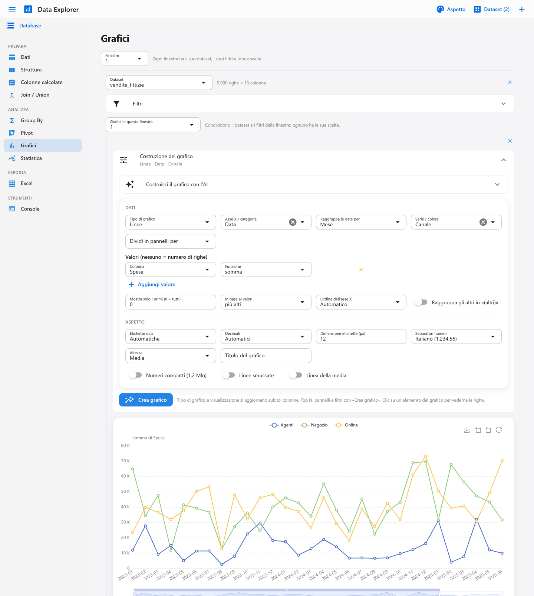

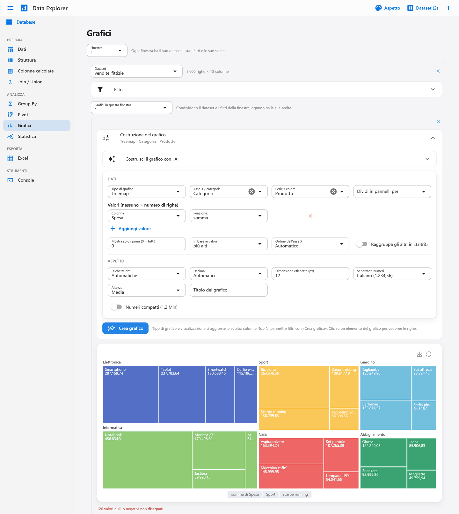

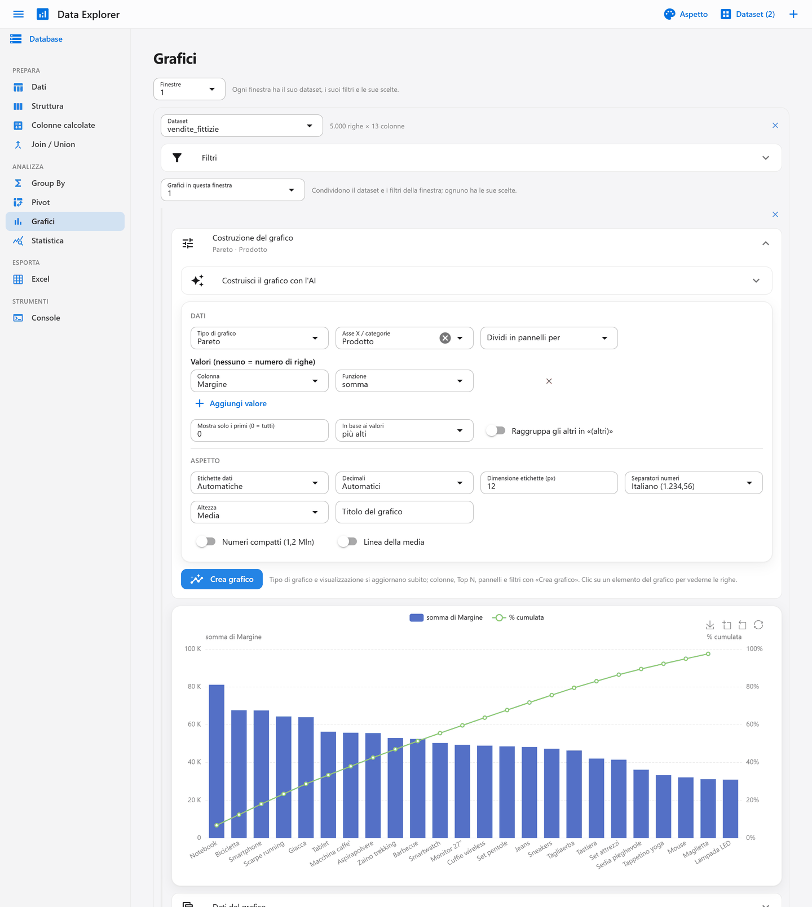

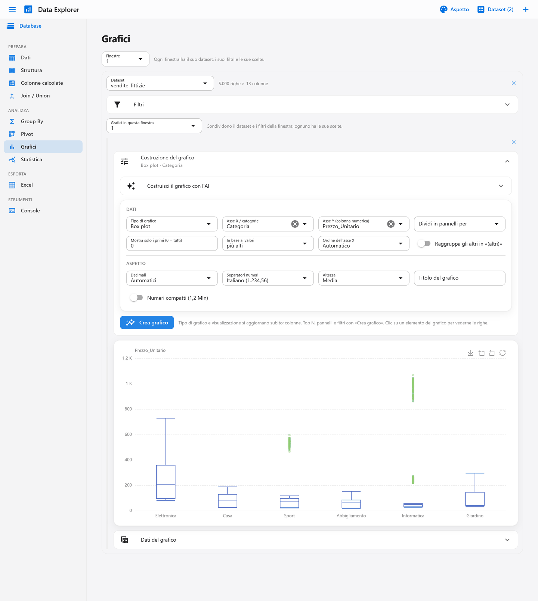

</details>

In alto puoi anche usare **Costruisci il grafico con l'AI**: descrivi in italiano il grafico che vuoi e l'assistente compila i controlli per te (serve la chiave API, [sezione 11](#11-assistente-ai-facoltativo)).

### Statistica

Scegli un'analisi, le colonne coinvolte e premi **Calcola**. I risultati sono tabelle e grafici numerici (nessun testo interpretativo).

| Gruppo | Analisi |
|--------|---------|
| Descrittive | Statistiche descrittive · Distribuzione e normalità · Frequenze · Valori anomali |
| Relazioni | Correlazioni |
| Test d'ipotesi | Confronto tra gruppi · Test su un campione · Campioni appaiati · Indipendenza tra categorie |
| Modelli | Regressione lineare · Regressione logistica · Serie temporale |

Ogni analisi mostra solo i campi che le servono (per esempio il livello di confidenza, il metodo di correlazione o l'unità di tempo).

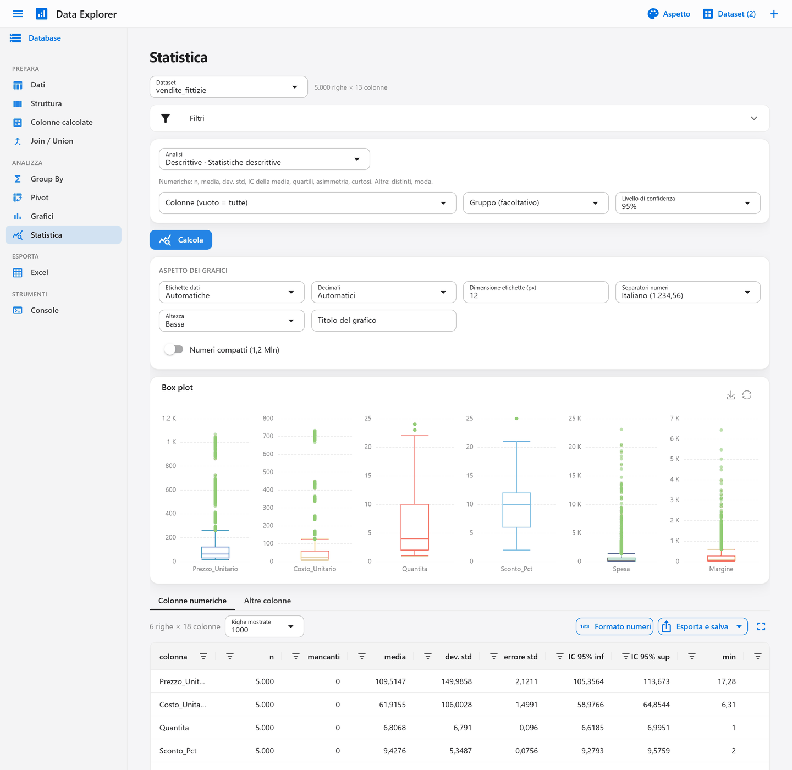

<details>
<summary>Correlazioni</summary>

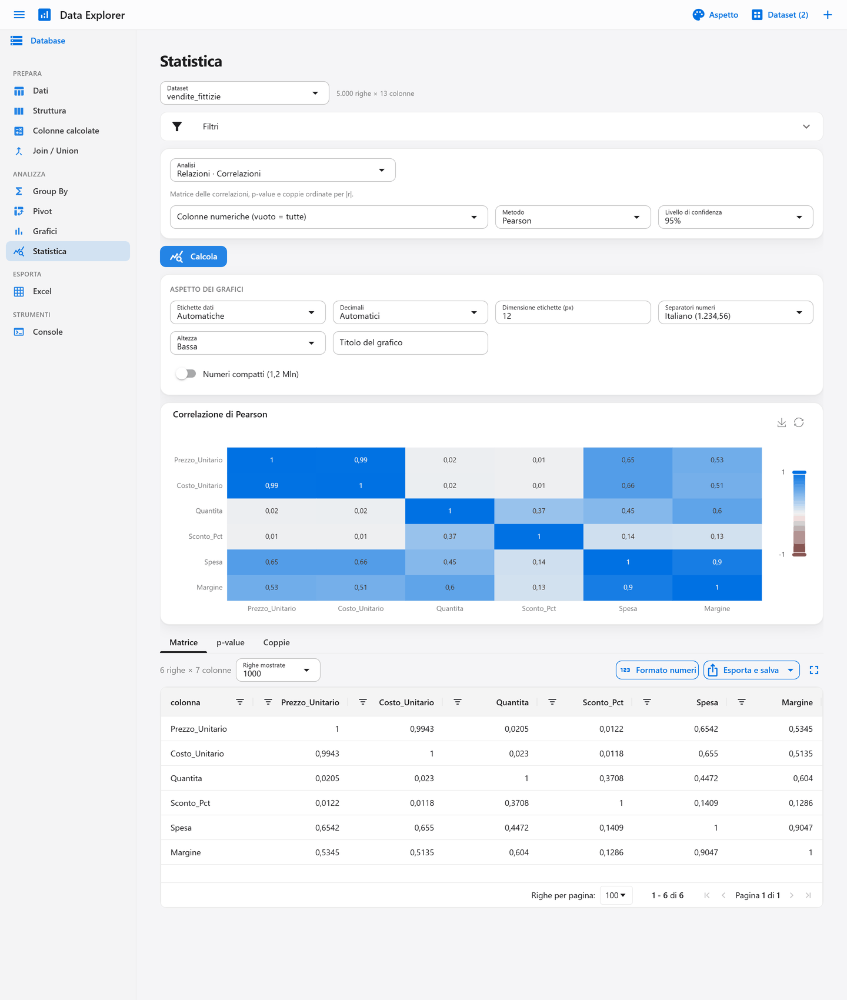

</details>

### Excel

Genera file Excel formattati. Un interruttore sceglie tra **Split** e **Report**.

**Split** divide un dataset in più file o più fogli:

- *Per valori di colonna*: un file (o un foglio) per ogni valore, per esempio uno per regione;
- *Per numero di righe*: blocchi di N righe, ciascuno in un file o in un foglio.

I nomi si compongono con segnaposto come `{Regione}`, `{n}` e `{nome}`. Il pulsante **Anteprima** mostra il piano (quanti file, quali nomi, quante righe) prima di creare qualsiasi cosa; **Genera file** li crea. Limiti: massimo 1.000 file e 250 fogli per file.

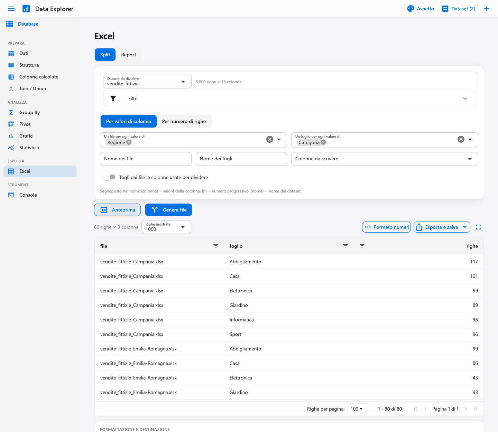

**Report** raccoglie in un solo file Excel più tabelle che hai prodotto nelle altre sezioni. Da qualsiasi risultato usa **Esporta e salva → Aggiungi al report**, scegliendo nome del foglio e titolo; poi in Report puoi riordinare, rinominare e togliere i fogli e premere **Genera report**.

**Impostazioni comuni** (valgono per Split e Report): stile della tabella di Excel (o intervallo semplice), riga dei totali, evidenziazioni condizionali sulle colonne numeriche, numeri negativi in rosso, foglio indice con collegamenti, intestazione bloccata. La destinazione può essere il **download** (un file singolo, oppure uno ZIP se i file sono più di uno) oppure una **cartella del PC** a tua scelta. Se un foglio supera il limite di righe di Excel (1.048.575 righe di dati), viene continuato automaticamente in un foglio successivo.

### Console

Per quello che non è coperto dai pulsanti. Un interruttore sceglie **SQL** o **Python**; `Ctrl+Invio` (oppure **Esegui**) lancia il codice.

**SQL** (DuckDB)

- Ogni dataset caricato è una tabella con il suo nome.
- `df` è il dataset della finestra.

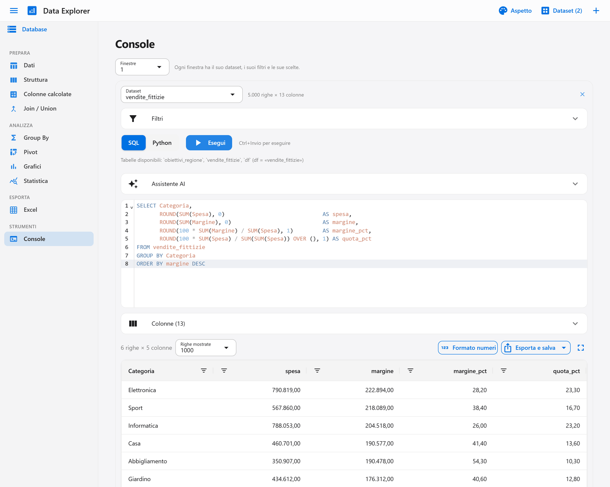

**Python**

- Variabili disponibili: `df` (il dataset della finestra), `datasets` (tutti i dataset, per nome), `pd` (pandas), `np` (numpy), `sql("SELECT …")` (esegue una query SQL e restituisce una tabella), `Dashboard` (vedi sotto).
- L'ultima riga viene mostrata come in Jupyter. Può essere una **tabella**, un **grafico** (opzioni ECharts, figura matplotlib o plotly, se installati) oppure una **dashboard**.
- Le variabili restano disponibili tra un'esecuzione e l'altra.

**Filtri nella Console:** i filtri in alto cambiano solo il contenuto di `df`; le altre tabelle SQL restano complete. Un avviso ricorda quando `df` è filtrato.

**Dashboard.** Il pulsante **Esempio di dashboard** inserisce un codice completo da modificare. In sintesi:

```python
dash = Dashboard(df, "Vendite")
dash.slicer("Regione")                                    # filtro laterale
dash.kpi("Fatturato", "Spesa", "somma", decimals=0, suffix=" €")
dash.chart("line", x="Data", value="Spesa", date_unit="Mese", series="Canale", width=8)
dash.table(groups=["Categoria"], value="Spesa")
dash.pivot(rows="Prodotto", columns="Regione", value="Spesa")
dash.page("Dettaglio")                                    # una nuova pagina (scheda)
dash                                                      # ultima riga: mostra la dashboard
```

I filtri laterali valgono per tutta la dashboard; cliccando su un elemento di un grafico gli altri riquadri si filtrano di conseguenza (filtro incrociato). Un pulsante porta la dashboard a schermo intero.

**Esempio di grafico** inserisce un esempio di grafico scritto nella Console.

**Assistente AI:** vedi [sezione 11](#11-assistente-ai-facoltativo).

---

## 9. Esportare e salvare i risultati

Sotto ogni risultato il menu **Esporta e salva** offre:

| Voce | Cosa fa |
|------|---------|
| **Excel** | Scarica un file `.xlsx` con tutte le righe. |
| **CSV** | Scarica un CSV in **formato italiano**: separatore `;` e virgola decimale. |
| **Apri in Excel** | Salva un file temporaneo e lo apre con Excel (richiede Excel sul PC). |
| **Salva come dataset** | Il risultato diventa un nuovo dataset su cui puoi rifiltrare, interrogare con SQL, ecc. |
| **Salva nel database** | Lo conserva nel database locale ([sezione 10](#10-database-dei-dataset)). |
| **Aggiungi al report** | Lo aggiunge al report Excel ([sezione Excel](#excel)). |
| **Nota** | Mostra o modifica la nota di origine. |

**Schermo intero** apre la tabella in una finestra massimizzata.

> L'esportazione contiene sempre **tutte** le righe, indipendentemente dal limite «Righe mostrate».

---

## 10. Database dei dataset

Il pulsante **Database** (in cima al menu laterale) apre un archivio locale in cui conservare i dataset tra una sessione e l'altra: i dati che carichi dai file, altrimenti, spariscono alla chiusura del programma.

- I dataset sono organizzati in **progetti** e **sottocartelle** annidabili (**Nuovo progetto**, **Nuova sottocartella**).
- Su una cartella: **Salva qui** salva un dataset caricato, poi si può rinominare o eliminare.
- Su un dataset: **Apri** lo carica nell'app; si possono scrivere o modificare le **note**, rinominarlo, spostarlo in un'altra cartella, eliminarlo.
- Ogni dataset salvato conserva una **nota di origine** (file di partenza, filtri applicati, operazioni svolte), così sai sempre da dove viene; puoi anche aggiungere una tua nota scritta a mano.
- I dataset si salvano **così come sono** in quel momento (istantanee): non vengono ricalcolati.

Il database è un singolo file DuckDB, per impostazione predefinita `data/workspace.duckdb` dentro la cartella del programma. Per usarne uno diverso: `python main.py --db percorso\mio_database.duckdb`.

> Il file si può aprire da **un solo programma alla volta**: non avviare due copie di Data Explorer sullo stesso database.

---

## 11. Assistente AI (facoltativo)

L'assistente AI è una comodità, non è necessario per usare il programma.

**Cosa fa**

- Nella **Console** (riquadro *Assistente AI*): descrivi in italiano ciò che vuoi e **Genera codice** scrive il codice SQL o Python nell'editor. Il codice **non viene eseguito**: lo controlli, lo modifichi e lo lanci tu.
- Nei **Grafici** (*Costruisci il grafico con l'AI*): descrivi il grafico e i controlli vengono compilati al posto tuo.

**Come attivarlo**

1. Crea una chiave API sul sito di Anthropic (console.anthropic.com).
2. Incollala nel campo **API key Anthropic**.
3. Scegli il **modello** (Fable 5.1, Opus 5.5, Sonnet 5.5, Haiku 5.5: dal più capace al più veloce ed economico) e lo **sforzo** di ragionamento (predefinito del modello, basso, medio…).

L'uso dell'API è a pagamento secondo le tariffe di Anthropic. La chiave non viene salvata su disco: va reinserita a ogni avvio.

**Privacy**

All'API vengono inviati **solo** la tua richiesta e i **metadati** dei dati: nomi delle tabelle e delle colonne con i relativi tipi. **I valori contenuti nei tuoi dati non vengono mai inviati.**

---

## 12. Opzioni di avvio avanzate

```
python main.py [file ...] [--port N] [--db percorso.duckdb]
```

| Opzione | Significato | Predefinito |
|---------|-------------|-------------|
| `file ...` | File da caricare all'avvio (anche più di uno). Il nome del dataset è il nome del file senza estensione. | nessuno |
| `--port N` | Porta del server. Utile se la 8090 è occupata, o per avviare due istanze separate (ognuna con il proprio `--db`). | `8090` |
| `--db percorso.duckdb` | File del database dei dataset. | `data/workspace.duckdb` |

Esempi:

```
python main.py vendite.csv --port 8123
python main.py --db D:\Analisi\progetto1.duckdb
```

### Da Jupyter

Dentro un notebook, con la cartella del progetto nel percorso di Python:

```python
from data_explorer.launcher import explore
explore(vendite=df_vendite, clienti=df_clienti)   # i nomi diventano i nomi dei dataset e delle tabelle SQL
explore(df)                                       # un solo DataFrame: si chiama «df»
```

L'app parte in un processo separato e il notebook resta libero. Se l'app è già aperta sulla stessa porta, chiudila e rilancia `explore`: l'invio dei DataFrame a un'app già in esecuzione non è ancora completo.

---

## 13. Problemi frequenti

**Il browser non si apre / la pagina non si carica.**
Controlla che il Prompt dei comandi sia ancora in esecuzione e vai su http://localhost:8090 (o sulla porta indicata con `--port`).

**«Address already in use» / la porta è occupata.**
Un'altra copia del programma è già in esecuzione. Chiudila (`Ctrl+C` nel suo Prompt dei comandi) oppure avvia questa su un'altra porta: `python main.py --port 8123`.

**Ho modificato il codice ma non cambia nulla.**
L'app non si ricarica da sola: ferma con `Ctrl+C` e rilancia `python main.py`. Se un vecchio processo occupa ancora la porta, il browser continua a parlare con il codice vecchio (un indizio: i dataset caricati sono ancora lì).

**Il database dà errore all'apertura.**
Il file DuckDB può essere aperto da un solo programma alla volta. Chiudi le altre copie di Data Explorer (o altri programmi che lo usano).

**«Range Excel» rifiuta l'importazione.**
Salva prima la cartella di lavoro in Excel: il programma legge il file dal disco, non i dati non salvati. Verifica anche di aver selezionato un intervallo di celle (non un grafico o un oggetto).

**I numeri mostrati sono diversi da quelli del file (per esempio «2.024» al posto di 2024).**
È il *Formato numeri* di visualizzazione. Scegli *Nessun formato* sopra la tabella; i file scaricati non sono mai toccati dal formato.

**Le colonne con codici come `00123` hanno perso gli zeri.**
In fase di importazione imposta per quella colonna il formato *Testo*.

**La tabella mostra meno righe del file.**
Cambia **Righe mostrate** (fino a 10.000). L'esportazione contiene comunque tutte le righe.

**Il join si ferma con un messaggio sulla dimensione.**
Le chiavi scelte hanno molti valori ripetuti da entrambe le parti, quindi il risultato sarebbe enorme. Controlla le chiavi o filtra i dataset prima.

**La pivot ha troppe colonne.**
Filtra i dati oppure sposta un campo dalle colonne alle righe.

**L'app è lenta sul file caricato.**
Riduci il lavoro con i filtri o con una scelta di colonne più stretta in fase di importazione; le operazioni pesanti (pivot, join, statistica) girano in background, ma lavorano comunque in memoria.

---

## 14. Per chi sviluppa

### Struttura del progetto

```
.
├─ main.py                  punto di ingresso (python main.py)
├─ launcher.py              compatibilità con i vecchi notebook
├─ requirements.txt
├─ pytest.ini
├─ data_explorer/
│  ├─ app.py                interfaccia NiceGUI (stato, sezioni, componenti)
│  ├─ launcher.py           explore(): avvio da Jupyter
│  ├─ core/                 logica dati, senza interfaccia
│  │                        (engine, pivot, columns, combine, stats, structure,
│  │                         import_plan, number_format, workspace, notes, formula_help)
│  ├─ plotting/             dati e opzioni dei grafici
│  │                        (charts, chart_options, chart_ai, stats_charts)
│  ├─ excel_io/             scrittura Excel, split, report, collegamento a Excel
│  ├─ ai/                   assistente AI (ai_assistant)
│  └─ ui/                   stile (style) e dashboard della Console (dashboard)
├─ tests/                   test automatici
├─ tools/                   build_exe.ps1, exe_launcher.py, make_sample_sales.py
└─ docs/PROJECT_MAP.md      mappa tecnica del codice
```

Regola di fondo: **la logica sta nei moduli senza interfaccia** (`core`, `plotting`, `excel_io`, `ai`, `ui/dashboard.py`), testabili da soli; `app.py` fa solo da collante tra i controlli e quelle funzioni.

### Test

```
python -m pip install pytest pytest-asyncio
python -m pytest -q
```

I test dell'interfaccia usano il simulatore di NiceGUI (`nicegui.testing.user_plugin`).

### Documentazione tecnica

`docs/PROJECT_MAP.md` descrive il ruolo di ogni file, una tabella «se la richiesta riguarda X, intervieni in Y», le strutture dati principali e i punti di attenzione. Va aggiornato quando cambia la struttura del codice.

### Convenzioni

- Codice Python semplice e leggibile, variabili e funzioni in inglese.
- Nessun codice ridondante: prima di scrivere un helper, controllare che non esista già.
- Il codice è organizzato per argomenti: funzioni, logiche e architettura separate.
- Restano in italiano solo i testi visibili all'utente e alcune chiavi salvate o scambiate (descritte in `PROJECT_MAP.md`).

---

## 15. Licenza

Distribuito con licenza **MIT**: puoi usare, copiare, modificare e ridistribuire il codice, anche per scopi commerciali, purché mantieni l'avviso di copyright. Il testo completo è nel file [LICENSE](LICENSE).
